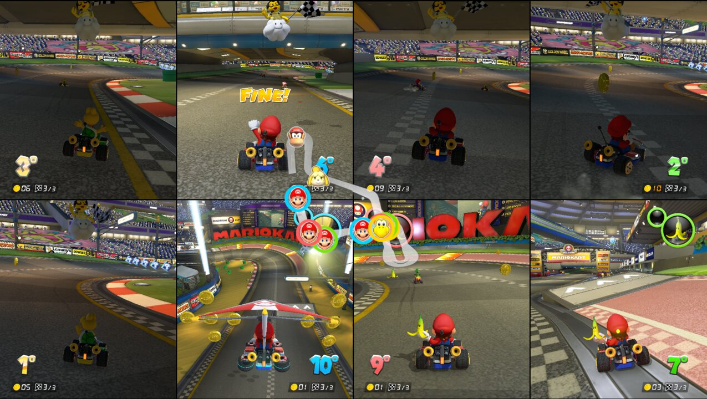
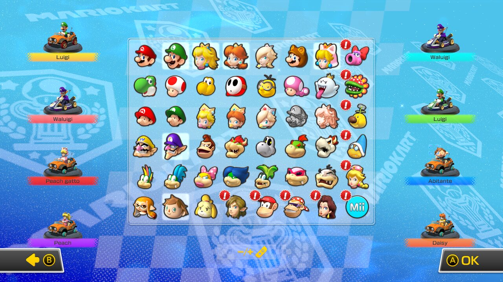

# mk8dx-8p

**5–8 player local split-screen for Mario Kart 8 Deluxe 4.0.1 on Switch 1.**



## What it is

Update 4.0.1 added a 5–8 player local mode that the game only allows on Switch 2. The Switch 1 executable already contains the menu part
and the RomFS already contains the 6P/8P layouts, but the rest of the flow is capped at 4 players. This mod is an
[exlaunch](https://github.com/shadowninja108/exlaunch) module (`subsdk9`) that lifts those caps by following the game's own flow with 8
players instead of 4:

- 8-player menu flow and controller applet, 8 controllers polled;
- character and kart selection with 8 cursors on the game's 8-player layout, variants and unlock gifts for P5–P8;
- races with 6 or 8 views (3×2 / 4×2), HUD, Lakitu and finish logo in every cell, spectator camera in the empty cell for 5 and 7 players;
- pause, results, Grand Prix with the final 12-row ranking.



No Nintendo code or assets are included: only the mod's source code and offsets into the game.

## Installation

**Requirements:** Switch 1 with **Atmosphère** custom firmware (stock firmware will not load it), Mario Kart 8 Deluxe with **update 4.0.1**,
5–8 controllers.

1. Download the latest `mk8dx-8p-release-*` package from the [Actions](../../actions) artifacts or the [Releases](../../releases).
2. Copy its `atmosphere/` folder to the root of the microSD card. Back up your save first.
3. Start the game and choose 5–8 players.

Details, uninstall and crash reports: [docs/INSTALL.md](docs/INSTALL.md).

**Tested:** Switch 1 (Atmosphère, docked, with SaltyNX) up to 6 players including a full Grand Prix; Eden emulator up to 8 players.
Not yet tested on hardware: 7–8 players and handheld mode.

## Development

- [PLAN.md](PLAN.md): how the mod works (areas, approach, main hooks). [STRUCTS.md](STRUCTS.md): reconstructed game structures.
  [docs/notes/](docs/notes/): development state and analysis notes (Italian). [CLAUDE.md](CLAUDE.md): working rules and debugging tips.
- Code: `src/program/main.cpp` (all hooks), `src/exlaunch_patch/` (fixes to exlaunch copied over the submodule at build time).
  Offsets are into the decompressed main NSO of 4.0.1 (BID `158C0C7399AABD7BF83795C2EF3484C7`).

**Build** (Docker with `devkitpro/devkita64`):
```sh
git submodule update --init
scripts/build.sh                 # release build -> exlaunch/deploy/{subsdk9,main.npdm}
MK8DX_LOG=1 scripts/build.sh     # with debug log lines "[mk8dx-8p]" (svcOutputDebugString)
scripts/package.sh               # dist/mk8dx-8p-{release,diagnostic}-<commit>/ + zip
```
CI (`.github/workflows/build.yml`) builds the release package on every push (`DKP_NATIVE=1` builds inside the container without Docker).

**Build options** (environment variables, full list at the top of `scripts/build.sh`):

| variable | default | meaning |
|---|---|---|
| `MK8DX_LOG` | 0 | debug log lines; needed for emulator testing |
| `MK8DX_EXCDIAG` | 1 | on a crash, put the fault context in the Atmosphère report registers (X03 pc, X04 far, X05 esr, X06 lr, X07 sp) |
| `MK8DX_MODELDIAG` | 0 | test only: stop with a code if a 3D model is not ready when extended |
| `MK8DX_VIEWS` | 8 | maximum race views |
| `MK8DX_TEXDESC` | 16640 | texture descriptors of the graphics device (0 = game value) |
| others | | feature switches for bisection (`MK8DX_GIFT8`, `MK8DX_SEL8B`, …) |

**Testing in an emulator:** `EDEN_DIR=/path/to/portable/eden scripts/deploy.sh` copies the build to Eden's mod folder and
`EDEN_DIR=… MK8D_GAME=/path/to/game.xci scripts/run-eden.sh` starts it (game, keys, firmware and emulator are not provided). Use
`MK8DX_LOG=1` builds and read `$EDEN_DIR/user/log/eden_log.txt`. Eden's GDB stub (port 6543) is useful to catch unmapped reads, which
return 0 in Eden but crash on hardware (`tools/debug/`: persistent gdb session and a loop that logs every stop).

**Reverse engineering:** decompress the main NSO from the 4.0.1 update (e.g. with `hactool` and an NSO decompressor), then
```sh
llvm-objcopy -I binary -O elf64-littleaarch64 --rename-section=.data=.text,code main.bin main.elf
llvm-objdump -d --triple=aarch64 main.elf > main.asm
```
Rule of thumb used throughout: find where the original code limits something to 4 and extend that same path to 8, instead of patching the
symptom.

## License

GPL-2.0, like exlaunch (see [LICENSE](LICENSE)). Mario Kart is a trademark of Nintendo; this project is not affiliated with Nintendo.
