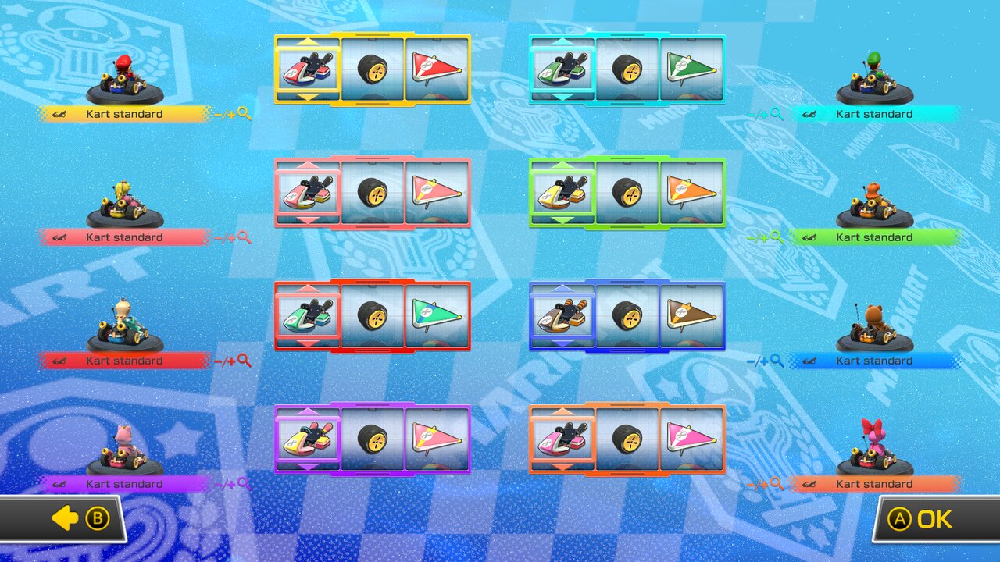
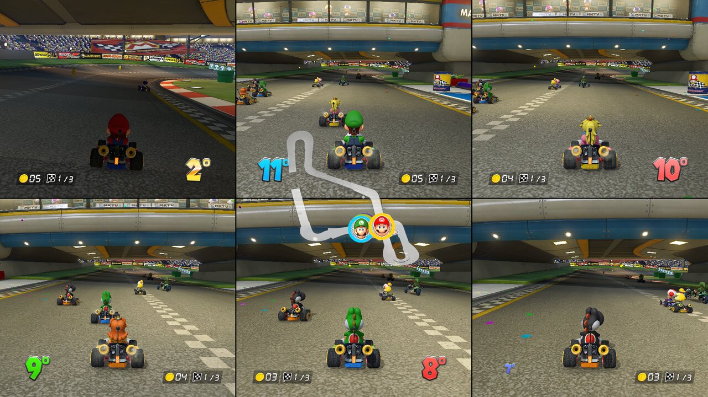

# mk8dx-8p

[](https://github.com/LorenzoMorelli/mk8dx-8p/actions/workflows/build.yml)
[](https://github.com/LorenzoMorelli/mk8dx-8p/releases/latest)
[](LICENSE)

**Play Mario Kart 8 Deluxe with up to 8 players in local split-screen on the original Switch.**

| 8-player character selection | 8-player kart selection |
|---|---|
|  |  |
| **8-player race (4×2)** | **6-player race (3×2)** |
|  |  |

Update 4.0.1 added 5–8 player local split-screen, but only on Switch 2. This mod unlocks it on Switch 1:

- 8 controllers in the menus and in the controller applet;
- character and kart selection with 8 cursors on the game's own 8-player layout;
- races in 3×2 and 4×2 split-screen with the full HUD, and a spectator camera in the empty cell with 5 or 7 players;
- pause, results and complete Grand Prix.

Tested on the [Eden](https://eden-emu.dev) emulator and on a real Switch 1 ([details](docs/INSTALL.md#tested)).

## Requirements

- Mario Kart 8 Deluxe **updated to 4.0.1** (other versions are not supported).
- A Switch 1 with **Atmosphère** custom firmware, or the Eden emulator.
- 5–8 controllers.

## Install on Switch

0. Back up your save data (e.g. with JKSV): the mod is experimental.
1. Download `mk8dx-8p-release-*.zip` from the [latest release](../../releases/latest) and unzip it.
2. Copy the `atmosphere` folder to the root of the microSD card, merging it with the one already there. You should end up with:
   ```
   /atmosphere/contents/0100152000022000/exefs/subsdk9
   /atmosphere/contents/0100152000022000/exefs/main.npdm
   ```
3. Boot Atmosphère, start the game and choose 5–8 players.

## Install on Eden

1. Download and unzip the release as above.
2. In Eden, right-click Mario Kart 8 Deluxe and choose **Open Mod Data Location**.
3. In that folder create `mk8dx-8p/exefs/` and copy `subsdk9` and `main.npdm` into it (inside the zip they are in
   `atmosphere/contents/0100152000022000/exefs/`).
4. Make sure `mk8dx-8p` is enabled in the game's **Properties → Add-ons**, then start the game.

## Uninstall

Delete `/atmosphere/contents/0100152000022000/exefs/` from the microSD card (Switch) or the `mk8dx-8p` folder (Eden).

## Compatibility and bug reports

- Only update 4.0.1: the mod checks the game code before patching it.
- Does not work on stock firmware.
- Do not combine it with other mods that replace the game's `subsdk9` or `main.npdm`.

Found a bug? Open an [issue](../../issues). If the game crashed on Switch, attach the newest `.log` from `/atmosphere/crash_reports/`.

## Development

The mod is an [exlaunch](https://github.com/shadowninja108/exlaunch) module (`subsdk9`). The Switch 1 executable already contains the
menu part of the 5–8 player mode and the RomFS already contains the 6P/8P layouts; the mod finds where the rest of the game stops at 4
players and extends that same path to 8. Build instructions, options, emulator testing and reverse-engineering tools:
[docs/DEVELOPMENT.md](docs/DEVELOPMENT.md).

No Nintendo code or assets are included: only the mod's source code and offsets into the game.

## Credits and license

Built on [exlaunch](https://github.com/shadowninja108/exlaunch) by shadowninja108. GPL-2.0, like exlaunch (see [LICENSE](LICENSE)).
Mario Kart is a trademark of Nintendo; this project is not affiliated with Nintendo.
